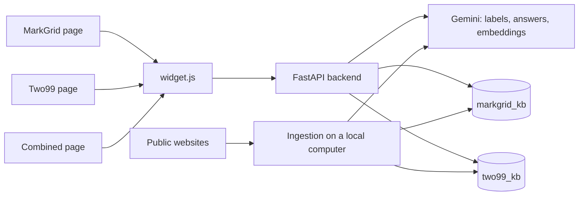

# BrandBridge AI: Project Documentation

## Document Control

| Field | Value |
|---|---|
| Document title | BrandBridge AI: One Chatbot, Two Brands (MarkGrid.ai & Two99) |
| Document ID | BB-DOC-001 |
| Document type | Technical project report (with project plan and registers) |
| Domain | IT / software: conversational AI (RAG) |
| Audience | Evaluator (client side) and delivery team |
| Version | v1.0 (baseline) |
| Created / last updated | 25 Nov 2026 / 25 Nov 2026 |
| Author / document owner | Anushka Gupta |
| Approver | Assignment evaluator (name to be added) |
| Sign-off status | **Pending** |
| Storage | Project Git repository; Git is the version history |

### Revision history

| Version | Date | Author | Change |
|---|---|---|---|
| v1.0 | 25 Nov 2026 | Anushka Gupta | Baseline issue |

### Status terms used

| Term | Meaning |
|---|---|
| Verified | Checked by a test or measurement |
| Built | Code exists; not verified in the live environment |
| Pending | Not done yet |
| TBC | To be confirmed by the owner or approver |

### Contents

1. [Executive Summary](#1-executive-summary)
2. [Background and Objectives](#2-background-and-objectives) (Initiation)
3. [Scope and Deliverables](#3-scope-and-deliverables) (Planning)
4. [Approach, Schedule and Resources](#4-approach-schedule-and-resources) (Planning)
5. [Solution Design](#5-solution-design) (Execution)
6. [Testing and Quality](#6-testing-and-quality) (Execution and Monitoring)
7. [Deployment and Operations](#7-deployment-and-operations) (Execution)
8. [Risks, Dependencies and Governance](#8-risks-dependencies-and-governance) (Monitoring)
9. [Status, Findings and Next Steps](#9-status-findings-and-next-steps) (Monitoring)
10. [Project Closure](#10-project-closure) (Closure)
11. [Appendices](#11-appendices)

---

## 1. Executive Summary

**Purpose.** BrandBridge AI is one AI chatbot that answers visitors' questions for two brands, MarkGrid.ai and Two99, without
mixing their information.

**Scope.** One backend, one embeddable chat widget, two separate knowledge bases, one test page per brand, and one combined
chat window for both brands.

**Approach.** Retrieval-augmented generation (RAG): the bot searches the chosen brand's own content and answers only from
what it finds.

**Expected value.** One system to maintain instead of two, answers based on each brand's public content, and layered
controls against brand mixing and invented facts.

| Area | Status on 25 Nov 2026 |
|---|---|
| Application | Built; 40 of 40 offline tests pass |
| Knowledge upload | **Incomplete:** MarkGrid 960 of 3,572 chunks; Two99 0 of 1,151 (203 earlier points are in use) |
| Deployment | Render configuration prepared; live service not verified in this document |
| Manual acceptance checks | 32 defined, results not recorded |
| Budget | Designed for free service tiers; no paid service planned |
| Main concern | The full upload needs about 4 daily quotas, beyond the target date (section 9.3) |

## 2. Background and Objectives

### 2.1 Problem statement
MarkGrid.ai and Two99 are related brands with different products. One shared chatbot could give one brand's facts as the
other's, or invent facts that neither website states.

### 2.2 Business case

| Option | Advantage | Disadvantage | Decision |
|---|---|---|---|
| Two separate chatbots | Simple separation | Duplicate code and deployments; doesn't meet the brief | Rejected |
| One chatbot, one shared knowledge base | Least setup | Depends on filters and prompts to separate brands | Rejected |
| **One chatbot, one knowledge base per brand** | One system; each search reads one brand only | Needs reliable brand detection | **Selected** |

### 2.3 Project charter

| Item | Description |
|---|---|
| Goal | One chatbot serving both websites with separated knowledge |
| Evaluator's main concern | No hallucination and no mixing of content |
| Constraint | About two days (target 26 Nov 2026, TBC); free-tier AI and hosting |
| Requester | Assignment evaluator |
| Owner | Anushka Gupta |

### 2.4 SMART objectives

| ID | Objective | Measure | Target date | Status |
|---|---|---|---|---|
| O1 | Serve both brands from one backend and one widget | One FastAPI app, one `widget.js` | 26 Nov 2026 | Built |
| O2 | Keep knowledge separate | One Qdrant collection per brand; separation tests pass | 26 Nov 2026 | Verified offline |
| O3 | Detect the site on the server | A `site`/`Origin` mismatch returns 403 | 26 Nov 2026 | Verified offline |
| O4 | Limit invented answers | All 32 manual checks pass | 26 Nov 2026 | Pending |
| O5 | Load all extracted content | 3,572 + 1,151 chunks stored | TBC | At risk |
| O6 | Publish a working demo | Live links in the README | 26 Nov 2026 | Pending |

### 2.5 Stakeholder analysis

| Stakeholder | Interest | Influence | Engagement |
|---|---|---|---|
| Assignment evaluator | Separation, accuracy, working demo | High | Repository, README, live links |
| Developer (Anushka Gupta) | Successful delivery | High | Daily work and tracking |
| MarkGrid.ai and Two99 | Correct brand information | Medium | Public content used as the source |
| Website visitors | Fast, correct answers | Low | Chat widget |

## 3. Scope and Deliverables

### 3.1 Scope

| In scope | Out of scope |
|---|---|
| Public web pages of both brands | Private or logged-in content |
| Crawl, clean, chunk, embed and upload | Scheduled, automatic re-crawling |
| Chat backend and embeddable widget | Accounts, chat storage, analytics |
| Brand pages and combined window | Changes to the real brand websites |
| Guardrails, greetings, cross-brand rules | Human handover, voice, payments |
| Free-tier deployment | Production scaling and service-level guarantees |

### 3.2 Requirements traceability

| ID | Requirement | Implementation | Status |
|---|---|---|---|
| R1 | Knowledge from public pages of each brand | `ingestion/ingest.py` | Built; upload incomplete |
| R2 | Knowledge clearly separated | `markgrid_kb` and `two99_kb` | Verified offline |
| R3 | One deployment and one backend | `backend/main.py`, `render.yaml` | Built |
| R4 | One embeddable widget | `widget/widget.js` | Built |
| R5 | Server-side site awareness | `resolve_brand()` in `backend/pipeline.py` | Verified offline |
| R6 | One chatbot answers for both websites | `backend/combined.py` | Verified offline |
| R7 | Deliberate cross-brand behaviour | `brands/shared.json`, `brands/combined.json` | Verified offline |
| R8 | Greetings and detailed questions | `classify()`, `route()` | Verified offline (with fake AI replies) |
| R9 | Decline off-topic and manipulation attempts | Intent labels with fixed replies | Verified offline (with fake AI replies) |
| R10 | No hallucination | Context-only prompt and fallback reply | Built; reduces the risk, can't guarantee zero |
| R11 | Two styled test pages | `demo/markgrid`, `demo/two99` | Built |
| R12 | Short README, repository, live links | `README.md`, GitHub | Live links pending |

### 3.3 Deliverables

| ID | Deliverable | Location | Status |
|---|---|---|---|
| D1 | Source code | Git repository | Built |
| D2 | Chat widget | `widget/widget.js` | Built |
| D3 | Brand test pages | `demo/markgrid`, `demo/two99` | Built |
| D4 | Combined chat page | `demo/combined`, also at the backend's `/` | Built |
| D5 | Two knowledge bases | Qdrant Cloud | Incomplete |
| D6 | README | `README.md` | Live links pending |
| D7 | Acceptance checks | `sample.md` | Written; results pending |
| D8 | Live demo | Render | Pending verification |

### 3.4 Work breakdown structure

```
1 BrandBridge AI
├── 1.1 Initiation:    requirements, technology choice
├── 1.2 Knowledge:     crawl, clean, chunk, embed and upload
├── 1.3 Backend:       brand detection, classification, retrieval, answers, guardrails
├── 1.4 Combined chat: router, labelled answers, clarification
├── 1.5 Frontend:      widget, brand pages, combined page
├── 1.6 Quality:       automated tests, acceptance checks
├── 1.7 Deployment:    Render services, settings, live verification
└── 1.8 Closure:       documentation, handover, sign-off
```

## 4. Approach, Schedule and Resources

### 4.1 Methodology
Short iterations: build one capability, test it, then refine. Settings live in environment variables and brand text in JSON
files, so most content changes need no code change.

### 4.2 Milestones

Dates with a commit come from Git history; others are targets.

| ID | Milestone | Date | Status |
|---|---|---|---|
| M1 | First commit and RAG chatbot implementation (`b89013f`, `ca33c46`) | 24 Nov 2026 | Done |
| M2 | Unified multi-brand chat (`7cbe6dd`) | 24 Nov 2026 | Done |
| M3 | Render configuration (`8bfea25`) | 24 Nov 2026 | Done |
| M4 | Chat page served at `/` (`235f959`) | 25 Nov 2026 | Done |
| M5 | Documentation baseline | 25 Nov 2026 | Issued; sign-off pending |
| M6 | Live verification and 32 checks | 26 Nov 2026 (target) | Pending |
| M7 | Full knowledge upload | TBC (about 4 daily quotas) | At risk |


### 4.3 Budget

| Item | Plan | Planned cost |
|---|---|---|
| Google Gemini API | Free tier | 0 |
| Qdrant Cloud | Free tier (owner to confirm) | 0 |
| Render (backend and static pages) | Free tier | 0 |
| GitHub | Free tier (owner to confirm) | 0 |
| Optional: Gemini billing for upload and demo | Pay as you go | Not estimated; check current prices |

Labour cost and hours were not tracked, so no timesheet is included.

### 4.4 RACI matrix

R = Responsible, A = Accountable, C = Consulted, I = Informed

| Activity | Developer | Evaluator |
|---|---|---|
| Requirements | R | A |
| Design and build | R/A | I |
| Knowledge ingestion | R/A | I |
| Testing | R/A | I |
| Deployment | R/A | I |
| Acceptance and sign-off | C | R/A |

### 4.5 Communication plan

| Communication | Audience | Channel | When |
|---|---|---|---|
| Requirement questions | Evaluator | Agreed message channel | As needed |
| Progress and changes | Delivery team | Git commits, section 9 | Each change |
| Submission | Evaluator | Repository and live links | Target date |

## 5. Solution Design

### 5.1 Architecture



### 5.2 Technology

| Layer | Technology | Reason |
|---|---|---|
| Backend | Python, FastAPI | Request validation, small codebase |
| Chat model | `gemini-3.5-flash-lite` | Available on the free tier used |
| Embeddings | `gemini-embedding-001` (3,072 dimensions) | Same provider and key as chat |
| Vector database | Qdrant, cosine similarity | One collection per brand |
| Fallback search | BM25 keyword search | Used when query embedding is unavailable |
| Widget | Plain JavaScript, Shadow DOM | No build step; isolated styles |
| Ingestion | requests, BeautifulSoup, lxml | Reads public HTML pages |

### 5.3 Processing flow

**Brand page**
1. The widget sends `site`, the message and recent history.
2. The server maps `Origin` to a brand. It must match `site`, otherwise 403. If `Origin` is absent, the origin of `Referer`
   is used.
3. The message is classified. Greeting and brand questions continue; out-of-scope labels get a fixed reply.
4. For brand questions, only that brand's collection is searched.
5. Gemini answers from the retrieved text only.
6. If the answer names the other brand, it is regenerated once, then replaced with a safe reply.

**Combined window**
1. The router labels the question as one brand, both, compare, unclear, greeting, related, off-topic or injection.
2. If one brand is named and the label is a brand or unclear, that name decides the brand.
3. Each brand is searched and answered separately, without chat history. Answers are labelled by brand.
4. If the brand is unclear, the bot asks which company is meant.

### 5.4 Why one window has two brand pages beside it
The brand pages meet the two-test-page requirement and prove server-side site awareness. The combined window was added when
the evaluator confirmed that one chatbot answers for both websites. The pages share the same backend and widget; the
knowledge bases were not merged.

| Page | Local address | Brand chosen by |
|---|---|---|
| MarkGrid | `http://localhost:5500` | Website origin |
| Two99 | `http://localhost:5501` | Website origin |
| Combined | `http://localhost:5502` | The question |

### 5.5 Cross-brand behaviour

| Question | Brand page | Combined window |
|---|---|---|
| About the other brand | Declines and links to it | Answers from that brand's data |
| Fits either brand | Answers for the current brand | Asks which company |
| Compare / which is better | Describes the current brand | Describes each, picks no winner |
| Relationship | "MarkGrid is built by Two99." | Same |
| Off-topic or manipulation | Declines | Declines |
| Not in the knowledge base | Says it doesn't know, gives the contact link | Same |

### 5.6 Separation and accuracy controls

| Control | Protects against |
|---|---|
| Separate collections | Search results from the wrong brand |
| Lines naming the other brand removed in ingestion | Mixed source text |
| Origin allowlist | A page claiming another brand |
| No history in combined answers | Earlier text about the other brand |
| Leak check with one retry | The other brand's name in a brand answer |
| Context-only prompt and fallback | Invented answers |

These controls reduce the risk; an AI model cannot guarantee zero errors.

### 5.7 API

| Method and path | Purpose | Main responses |
|---|---|---|
| `GET /` | Combined chat page | 200 |
| `GET /config.js` | Sets the page's backend address to its own address | 200 |
| `GET /health` | Service check | 200 `{"status":"ok"}` |
| `GET /widget.js` | Chat widget | 200 |
| `GET /config?site=` | Widget text and limits | 200, 403 |
| `POST /chat` | Answer a message | 200, 403, 422, 500, 503 |

`POST /chat` request: `{"site": "combined", "message": "...", "history": []}`
Response fields: `brand`, `intent`, `reply`, `suggestions`

### 5.8 Security and privacy

| Topic | Position |
|---|---|
| Secrets | Read from `.env` locally (git-ignored) and the host's settings online; never stored in code |
| Input | Message length limited; roles validated; history trimmed |
| Prompt injection | Classified and declined; messages and context are treated as data |
| Data storage | Chat messages are not stored by the application; they are sent to Gemini to produce answers |
| Known gaps | No login and no rate limiting; non-browser clients can fake `Origin` |

## 6. Testing and Quality

### 6.1 Test summary

| Test type | Coverage | Result (25 Nov 2026) |
|---|---|---|
| Automated, offline | 40 tests: origin, separation, leak check, fallback, routing, ingestion, Gemini errors | **40 passed** |
| Manual acceptance | 32 checks in `sample.md` | Results not recorded |
| Live deployment | Links, settings, answers | Pending |
| Load and performance | Not planned for this stage | Not run |

Offline tests use fake AI replies. They verify the program's logic, not the AI model's answer quality.

Command: `venv\Scripts\python -m pytest -q`

### 6.2 Acceptance criteria

| ID | Criterion | Evidence |
|---|---|---|
| A1 | Automated tests pass | Test output |
| A2 | No answer presents one brand's facts as the other's | `sample.md` checks 13 to 20 and 27 to 32 |
| A3 | Unknown facts are not invented | `sample.md` checks 17 to 19 and 26 |
| A4 | Off-topic and manipulation messages are declined | `sample.md` checks 22 to 25 |
| A5 | Live pages load and answer | Live verification record |

## 7. Deployment and Operations

### 7.1 Target environment

| Component | Host | Note |
|---|---|---|
| Backend, widget, combined page at `/` | Render web service (free) | May sleep when idle, so the first request is slow |
| Brand pages and separate combined page | Render static sites | Optional combined page: the backend also serves one |
| Knowledge | Qdrant Cloud | Two collections |
| AI | Gemini API | Free-tier limits apply |
| Ingestion | Local computer | Not run on the server |

### 7.2 Deployment steps
1. Push the code to GitHub.
2. In Render, create a Blueprint from `render.yaml`.
3. Enter `GEMINI_API_KEY`, `QDRANT_URL`, `QDRANT_API_KEY`, `ORIGIN_BRAND_MAP` and `BACKEND_URL` in the dashboard.
4. After the addresses are known, set `ORIGIN_BRAND_MAP` to `origin=site` pairs, comma separated. Include the backend's own
   address as `combined`, because it serves the chat page.
5. Set `BACKEND_URL` on each static site to the backend address, then redeploy.
6. Check `/health`, open each page, and run `sample.md`.

### 7.3 Local operation

```powershell
python -m venv venv
venv\Scripts\python -m pip install -r requirements.txt
copy .env.example .env      # set the keys; leave QDRANT_URL empty for local storage
.\start.bat
```

A local Qdrant folder starts empty, so run ingestion before asking questions.

### 7.4 Knowledge update

```powershell
venv\Scripts\python -m ingestion.ingest --brand two99 --cached      # reuse saved text
venv\Scripts\python -m ingestion.ingest --brand markgrid            # crawl again
```

Uploads resume where they stopped. Restart the backend afterwards to refresh the keyword index. Outdated points are removed
only after all new chunks are saved.

### 7.5 Troubleshooting

| Symptom | Likely cause | Action |
|---|---|---|
| 403 from `/config` or `/chat` | Page address missing from `ORIGIN_BRAND_MAP` or wrong site | Correct the setting, redeploy |
| Error 429 in ingestion | Gemini limit reached | Run again with `--cached` after the reset |
| "I'm a little busy right now" | Gemini limit or overload | Wait a minute |
| Widget missing | Wrong `BACKEND_URL` or sleeping backend | Check `/health`, then refresh |
| Backend fails at start | Missing setting or unknown site in the map | Read the host's log |

## 8. Risks, Dependencies and Governance

### 8.1 RAID register

Probability and impact are the author's judgement.

**Risks**

| ID | Risk | Probability | Impact | Mitigation | Owner |
|---|---|---|---|---|---|
| RK1 | Incomplete knowledge gives "I don't know" answers | High | High | Upload Two99 first; consider billing | Developer |
| RK2 | Gemini limits interrupt the demo | High | High | Pace questions; consider billing | Developer |
| RK3 | Hosting sleep delays the first reply | High | Medium | Open `/health` before the demo | Developer |
| RK4 | Router picks the wrong brand | Medium | High | Name check, clarification, labelled answers | Developer |
| RK5 | Invented or mixed answer | Medium | High | Controls in 5.6; manual checks | Developer |
| RK6 | Wrong origin settings block pages | Medium | High | Step 4 of 7.2; live check | Developer |
| RK7 | Public use consumes the quota | Medium | Medium | Add rate limiting | Developer |
| RK8 | Website content changes | Medium | Low | Run ingestion again | Developer |

**Assumptions**

| ID | Assumption |
|---|---|
| AS1 | Public pages may be used as the source for this evaluation |
| AS2 | Free-tier limits stay as currently observed |
| AS3 | The evaluator tests the hosted chatbot directly |

**Issues**

| ID | Issue | Action | Status |
|---|---|---|---|
| IS1 | Knowledge upload incomplete | Continue after each quota reset | Open |
| IS2 | Live links missing from README | Add after verification | Open |
| IS3 | Manual check results not recorded | Run `sample.md` | Open |
| IS4 | `architecture_structural.md` refers to the removed `explain.md` | Correct the reference | Open |
| IS5 | Vercel address returned "Not found" | Moved to Render | Closed |

**Dependencies**

| ID | Dependency | Needed for |
|---|---|---|
| DP1 | Gemini API | Labels, answers, embeddings |
| DP2 | Qdrant Cloud | Knowledge search |
| DP3 | Render and GitHub | Hosting and deployment |
| DP4 | Public brand websites | Source content |

### 8.2 Change control
1. Record the request in the change log. 2. Assess scope, risk and schedule. 3. The owner approves it; the evaluator approves
scope changes. 4. Implement and run the tests. 5. Update this document and its version (minor edits v1.1, major changes v2.0).

| ID | Date | Change | Reason | Status |
|---|---|---|---|---|
| CR1 | 24 Nov 2026 | Added the combined window | Evaluator confirmed one chatbot for both sites | Done |
| CR2 | 24 Nov 2026 | Gemini used instead of OpenAI | Owner's choice | Done |
| CR3 | 24 Nov 2026 | Vercel replaced by Render | Owner's choice after the deployment issue | Configured |
| CR4 | 25 Nov 2026 | Combined page served at `/` | The backend address opens the chatbot | Built |

### 8.3 Reporting cadence
Until sign-off, section 9 is updated after each milestone or major change. Open risks and issues are reviewed at the same time.

## 9. Status, Findings and Next Steps

### 9.1 Status (25 Nov 2026)

| Area | Rating | Reason |
|---|---|---|
| Scope | Green | Planned functions are built |
| Quality | Amber | Offline tests pass; manual checks not recorded |
| Schedule | Amber | Live verification is still open |
| Knowledge data | Red | Upload incomplete |
| Cost | Green | No paid service planned |

### 9.2 Metrics

| Metric | MarkGrid | Two99 |
|---|---|---|
| Pages crawled | 512 | 244 (217 after duplicates) |
| Chunks from the full crawl | 3,572 | 1,151 |
| New chunks stored | 960 (27%) | 0 (0%) |
| Earlier points still in use | 275 | 203 |
| Points in Qdrant, checked 25 Nov 2026 | 1,235 | 203 |

### 9.3 Findings
- **Fact:** 3,763 chunks remain (2,612 MarkGrid and 1,151 Two99). The observed free limit is 1,000 embeddings a day.
- **Conclusion:** the rest needs about 4 daily quotas, so a full free-tier upload won't finish by 26 Nov 2026. Chat questions
  also use embeddings.
- **Fact:** when query embedding is unavailable, keyword search answers from the stored chunks only.
- **Opinion:** Two99 should be uploaded first, since it has the thinnest coverage.

### 9.4 Next steps

| Priority | Action | Owner | Due |
|---|---|---|---|
| 1 | Upload Two99 after the quota resets | Developer | 25 Nov 2026 |
| 2 | Verify the live service and origin settings | Developer | 25 Nov 2026 |
| 3 | Run and record the 32 checks | Developer | 26 Nov 2026 |
| 4 | Add live links to the README | Developer | 26 Nov 2026 |
| 5 | Continue the MarkGrid upload | Developer | TBC |
| 6 | Decide on Gemini billing and rate limiting | Developer | TBC |

## 10. Project Closure

### 10.1 Punch list

| Item | Status |
|---|---|
| Automated tests pass | Done |
| Documentation baseline issued | Done |
| Knowledge upload complete | Open |
| Live deployment verified | Open |
| Manual checks recorded | Open |
| README live links added | Open |
| Evaluator sign-off | Open |

### 10.2 Lessons learned

| Lesson | Applied or recommended action |
|---|---|
| Daily AI quotas affect data loading more than code | Resumable upload; plan quota early |
| A prompt alone is not enough for separation | Separate storage, routing and output checks |
| Hosting must suit a long-running backend | Render web service chosen |
| Free AI services can be busy | Retries, keyword fallback, clear busy message |
| Passing offline tests do not prove answer quality | Manual live checks added |

### 10.3 Final sign-off

| Role | Name | Decision | Signature | Date |
|---|---|---|---|---|
| Document owner | Anushka Gupta | Pending | | |
| Approver (evaluator) | TBC | Pending | | |

## 11. Appendices

### Appendix A: Repository

| Path | Purpose |
|---|---|
| `backend/main.py` | API endpoints and site check |
| `backend/pipeline.py` | Classification, retrieval, answers |
| `backend/combined.py` | Router for the combined window |
| `backend/clients.py` | Gemini and Qdrant connections |
| `backend/keyword_search.py` | Fallback search |
| `backend/config.py` | Settings and brand files |
| `brands/*.json` | Brand profiles, prompts, replies |
| `ingestion/ingest.py` | Crawl to upload |
| `widget/widget.js` | Chat widget |
| `demo/` | Test pages |
| `tests/test_chat.py` | Automated tests |
| `render.yaml` | Deployment configuration |
| `sample.md` | Acceptance checks |

### Appendix B: Settings

| Setting | Example or default file value | Purpose |
|---|---|---|
| `GEMINI_API_KEY`, `QDRANT_API_KEY` | Secret | Service access |
| `QDRANT_URL` | Set per environment | Cloud database; empty means local storage |
| `LLM_BASE_URL` | Gemini endpoint | AI address |
| `MODEL_MAIN`, `MODEL_INTENT` | `gemini-3.5-flash-lite` | Answers; labels |
| `EMBED_MODEL` | `gemini-embedding-001` | Embeddings |
| `LLM_MAX_RETRIES`, `LLM_TIMEOUT` | 3; 60 s | AI retries and timeout |
| `QDRANT_TIMEOUT` | 120 s | Database timeout |
| `QDRANT_PATH` | `data/qdrant` | Local storage folder |
| `ORIGIN_BRAND_MAP` | `http://localhost:5502=combined` | Allowed origins and their site |
| `TOP_K`, `MIN_SCORE` | 5; 0.25 | Chunks used; minimum similarity |
| `MAX_MESSAGE_CHARS`, `HISTORY_TURNS` | 1,000; 6 | Input limits |
| `CHUNK_CHARS`, `CHUNK_OVERLAP` | 1,800; 250 | Chunk size and overlap |
| `MAX_PAGES`, `CRAWL_DELAY`, `MIN_PAGE_CHARS` | 1,000; 1 s; 200 | Crawl limits |
| `COMMON_SHARE`, `COMMON_MIN_PAGES` | 0.3; 5 | Repeated-text detection |
| `EMBED_BATCH`, `EMBED_DELAY` | 32; 30 s | Upload pacing |
| `BACKEND_URL` | Backend address | Static site build only |

### Appendix C: Glossary

| Term | Meaning |
|---|---|
| RAG | Answering from retrieved text instead of model memory alone |
| Chunk | A small piece of page text |
| Embedding | Numbers representing the meaning of text |
| Collection | A separate group of records in Qdrant |
| Origin | The scheme, host and port of the page making a request |
| Router | The step that decides which brand a question is about |
| RAID | Risks, Assumptions, Issues, Dependencies |
| RACI | Responsible, Accountable, Consulted, Informed |

### Appendix D: Related documents

| Document | Purpose |
|---|---|
| `README.md` | Short overview and setup |
| `architecture_structural.md` | Detailed technical structure |
| `sample.md` | Manual acceptance checks |
